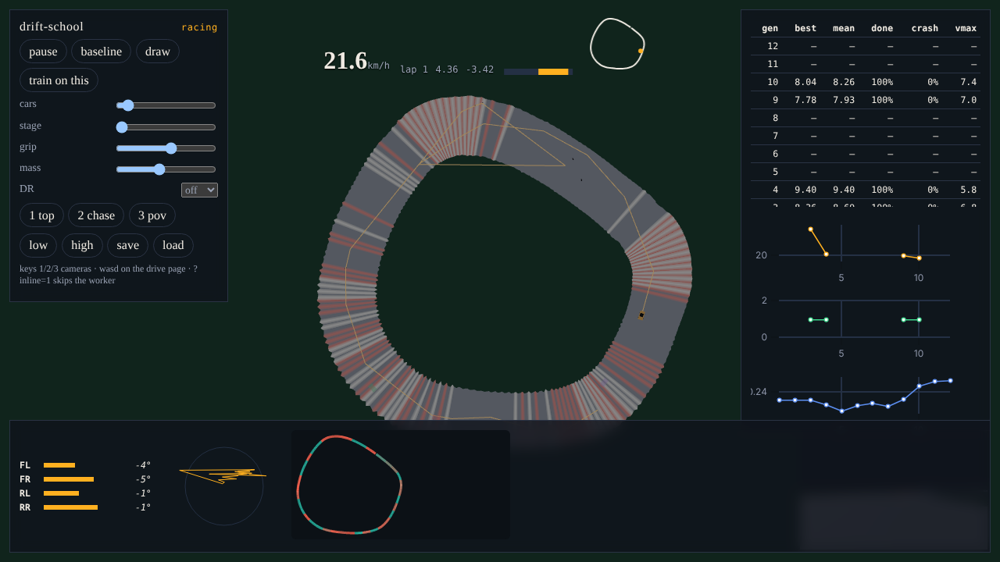
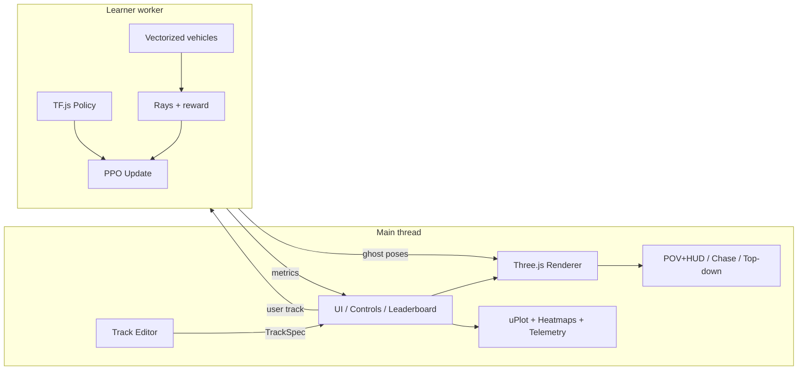
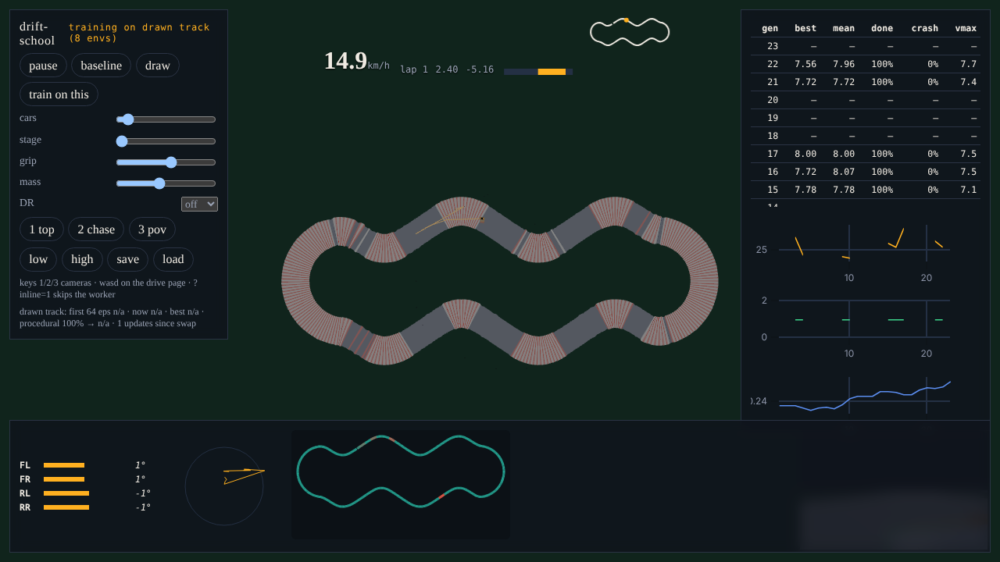
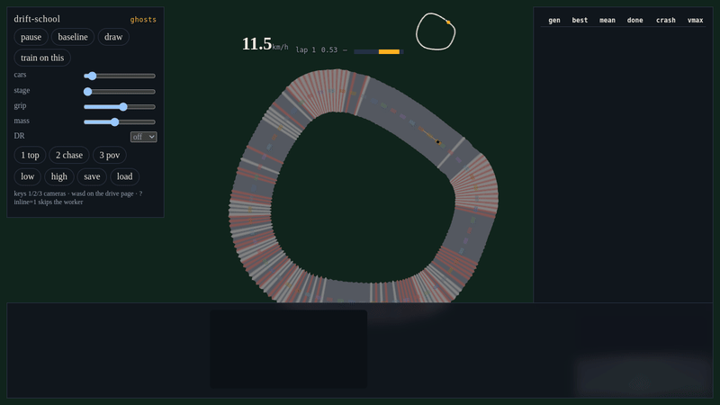

# drift-school

Draw a racetrack with the mouse and watch small RC cars learn to race it in the browser. Tire slip, suspension and weight transfer are simulated in TypeScript. A PPO policy, warm-started from a pure-pursuit teacher, trains in a worker next to the page. Rendering is Three.js (WebGPU when the browser allows it, WebGL2 otherwise). Nothing needs a server.



## Setup

```bash
npm install
npm run dev
```

Open http://127.0.0.1:5173 . The dev server sends `Cross-Origin-Opener-Policy: same-origin` and `Cross-Origin-Embedder-Policy: require-corp`. GitHub Pages cannot set those headers, so `public/coi-serviceworker.js` rewrites responses and reloads once. The Pages workflow uses `base: './'` and no repository secrets.

```bash
npm test           # unit tests (61)
npm run lint
npm run typecheck
npm run build
npm run bench      # wall-clock budgets (warm JIT, best of 7). Noisy on shared machines; PERF_SLACK=3 loosens them
npm run eval       # the SPEC section 3 acceptance table, measured. About 13 minutes (--quick, --only=stage0,matrix,hotswap,fps,physics)
npm run test:e2e   # Playwright: COOP/COEP, ghost view, editor, M3 and M4 browser checks
npm run media      # retake docs/media (needs `npm run dev` running)
```

Playwright downloads its own Chromium (`npx playwright install chromium`). To reuse a system Chromium, set `PW_CHROMIUM_PATH`. Software GL renders about 7 fps, so the e2e frame-rate floor is `E2E_MIN_FPS` (30 by default, 3 in CI); `E2E_STRICT_PERF=1` asserts the SPEC frame-rate and long-task bars on a machine with a GPU.

Keyboard driving, with Rapier walls, is at http://127.0.0.1:5173/dev/drive.html .

## Controls

| Input | Action |
| --- | --- |
| 1 / 2 / 3 | Top-down, chase, in-car POV |
| Draw | Freehand overlay. Release to simplify (RDP + Chaikin). Auto-closes if the ends are within 1 m |
| Train on this | Hot-swap. Every env restarts on the drawn track at once (the SPEC lets running episodes finish first; this does not wait). Then 70% drawn track, 30% procedural for the fine-tune, entropy 0.02. The live weights are forked under the track id, and the base checkpoint is saved first |
| Pause, baseline | Freeze learning, or watch pure pursuit |
| Stage, grip, mass, DR | Curriculum override and domain-randomization knobs |
| Save / load | Checkpoint in memory and IndexedDB |
| Leaderboard row | One row per update. Click to replay that update's stored pose tape (the first car only) |
| WASD or arrows | Only on the drive page |

A track in the URL hash is `deflate` of quantized millimeters. Round-trip error is at most 1 mm.

Query flags: `?view=ghosts` (64 cars, no training), `?cam=pov`, `?inline=1` (train on the main thread), `?quiet=1`, `?quality=high`.

## Architecture



The learner worker owns both the rollout and the update. `src/workers/env.worker.ts` can step a `VecEnv` on its own. There is not a four-worker SharedArrayBuffer pool.

Physics runs at 500 Hz inside each 50 Hz control step. Observations are 48 floats (21 rays plus speed, slip, and track-relative features). Actions are steer and throttle in [-1, 1].

## Acceptance tests (SPEC section 3)

Measured on this machine (Linux container, Node 22, CPU TF.js, software GL). `npm run eval` regenerates the eval rows; the rest come from `npm test`, `npm run bench` and `npm run test:e2e`.

| | Check | Bar | Result |
| --- | --- | --- | --- |
| M0 | `tsc --noEmit`, RNG determinism, worker ping, COOP/COEP | pass | **measured-pass** (typecheck in CI, unit tests, e2e header test) |
| M1 | Track generator: 1000 seeds x stages 0-4 valid, no fallback, same seed gives byte-identical output | all valid | **measured-pass** (5000 tracks, 0 fallbacks) |
| M1 | Generate under 20 ms; validate under 16 ms | budget | **measured-pass** in `npm run bench` (best-of-7, warm) |
| M1 | Known-bad fixtures rejected with the right reason; good fixtures pass | pass | **measured-pass** |
| M1 | Car: understeer sign, step-steer overshoot, launch top speed within 5%, determinism, 1e6 random steps without NaN | pass | **measured-pass** |
| M1 | Car step under 0.15 ms | 0.15 ms | **measured-pass**: full env step (10 substeps, 21 rays) is about 0.08 ms per car warm, one process |
| M1 | Braking from 5 m/s moves at least 10% of load to the front | 10% | **measured-pass** |
| M1 | Drift: rear slip above 15 degrees under low rear grip, recovers with countersteer | 15 deg | **measured-pass, with a caveat.** With rear grip scaled to 0.8 the car holds 42-46 degrees of rear slip at about 4 m/s and recovers to under 8 degrees when the steering is released. With rear grip at 0.5 it spins out (more than two full turns). The scripted recovery is "release the steer", not a countersteer controller, and it is a sustained slide, not a tuned drift |
| M2 | PPO solves the toy env | pass | **measured-pass** |
| M2 | Stage 0 lap completion at least 80% within 3 min, headless | 80% | **measured-pass**: 100% (16/16) on seeds never used in training, 5 s of imitation plus one PPO update. See below: this is not learning from scratch |
| M2 | Baseline car finishes all generated stage 0-2 tracks | pass | **measured-pass** (`tests/track/baseline.test.ts`) |
| M3 | 64 ghost cars at 50 fps or better | 50 fps | **not-run on a GPU.** Software GL measures 6.5 fps and does not depend on car count |
| M3 | Leaderboard rows equal updates | equal | **measured-pass** (browser: rows shown equal rows counted, no gaps) |
| M3 | Clicking a row replays a deterministic ghost lap | pass | **measured-pass**: the row replays the stored pose tape (first car only). The replay is a recording, so it is deterministic by construction; replaying a lap by re-simulating it is not implemented |
| M3 | No main-thread long task over 50 ms | 0 | **measured-fail on software GL**: 79 tasks, worst 388 ms in 25 s, all in rendering. Not measured on a GPU |
| M4 | Draw an S-curve with the mouse, valid | valid | **measured-pass** (Playwright mouse path) |
| M4 | Hot-swap: every env on the new track within 15 s | 15 s | **measured-pass**: 2.0-2.8 s end to end in the browser, 8 of 8 envs |
| M4 | Weights unchanged at swap | hash equal | **measured-pass** (browser and eval) |
| M4 | After 2 min, completion on the drawn track at least 80% | 80% | **measured-pass, but weak evidence**: 100% (16/16) after 120 s, and 100% before any fine-tuning, because the pure-pursuit-imitation policy already drives this S-curve. It shows the fine-tune does not hurt, not that it adapts |
| M4 | Procedural completion stays at 90% or more of its pre-swap value | 90% | **measured-pass**: 100% retained (100% before, 100% after) |
| M4 | URL hash round-trips the track | same track | **measured-pass** (to 1 mm) |
| M5 | Eval matrix (8 held-out seeds x asphalt, carpet, dirt x DR low, high) at least 70% | 70% | **measured-pass**: 99% (142/144). Worst cells carpet/high and dirt/high at 96% |
| M5 | POV, chase and top-down switch in under one frame | 1 frame | **not-run** |
| M5 | HUD values match state | match | **not-run** (HUD is fed from the same snapshot; not asserted) |
| M5 | High-preset fps budget | per spec | **not-run on a GPU** |

The matrix and the M2 number use a policy trained only on stage 0 on asphalt without randomization. Stages 1-4 and the curriculum promotion exist and are covered by unit tests, but no run here trained through them.

## What the learning actually does

- **Recipe.** `src/rl/recipe.ts` distils the pure-pursuit car with DAgger, stage by stage (0 to 3), under domain randomization and mixed asphalt/carpet/dirt, then runs a short validation-gated PPO phase (critic warm-up, clipped PPO, GAE with lambda 0.95 and gamma 0.99, tanh-Gaussian policy). Nearly all of the driving skill comes from the imitation; PPO moves lap time by about 1% at this budget and its updates are reverted unless they help on validation seeds (`NOTES/rl.md`). Stage 0 does not learn laps from a random policy at this training rate, so read the reward chart as fine-tuning, not as proof of from-scratch learning.
- **Hot-swap fine-tune.** Each env finishes its episode, then restarts on the drawn track; training is DAgger on the user track and a 30% procedural replay, interleaved with PPO (`NOTES/swap.md`).
- **Throughput.** The env steps at roughly 17k car-steps/s in one process after the wall grid (`NOTES/phys.md`); with the TF.js PPO update in the loop it is far slower. There is no SharedArrayBuffer worker pool, so the SPEC's 20k steps/s on 4 workers is not claimed.
- **Ghosts.** The worker streams car poses at about 30 Hz and the page draws them every animation frame. `?view=ghosts` is a synthetic 64-car demo with no training behind it.
- **Reproducibility.** Training is seeded end to end: a seed gives identical weights (`tests/rl/stage0.test.ts`), and eval seeds never overlap training seeds (`src/rl/seeds.ts`).
- **Reference time.** `tRef` on a generated track is an analytic curvature speed profile, not a simulated lap.
- **Walls.** Cars in the vectorized env bounce off wall polylines with a restitution impulse. Rapier is used only on the drive page.

## Known gaps

- The policy acts at 50 Hz, not the SPEC's 25 Hz.
- The replay tape records the first car only. Trainer replay tapes are kept in memory for the whole session.
- No track-width slider or surface brush in the editor; the drawn track has one width and one friction.
- The flip check is a roll-angle proxy at 0.85 rad (the vehicle model clamps roll at 0.9, so the SPEC's 80 degrees is unreachable).
- Drift is a sustained slide, not a controlled drift (see M1 above).
- `src/shared/messages.ts` documents intent; the worker wire protocol is the ad hoc messages in `main.ts` and `learner.worker.ts`. `src/workers/env.worker.ts` is not used by the page.
- Gates are generated but not used. The heatmap's crash definition differs from the leaderboard's.
- `sampleAtS` is a linear scan; chart arrays and the tape map are unbounded.
- The COOP/COEP service worker for GitHub Pages reloads once and has no loop guard beyond that.
- Visual polish: the kerb stripes render as dense hatching on bends, and in a 1280x720 window the right-hand panel scrolls behind the telemetry bar.

## Pictures

| | |
| --- | --- |
|  |  |
|  |  |
|  |  |

Captured with `npm run media` under software GL, so the capture is slow and the GIF is choppy. The POV, chase and top-down shots are the synthetic ghost view.

## Layout

`src/shared` contracts, `src/track` generator, `src/sim` vehicle and env, `src/rl` PPO, `src/editor` drawing and URL hash, `src/viz` Three.js, `src/ui` charts and leaderboard, `src/workers` learner and env.

## Credits and license

MIT. See [LICENSE](LICENSE) and [CREDITS.md](CREDITS.md).
