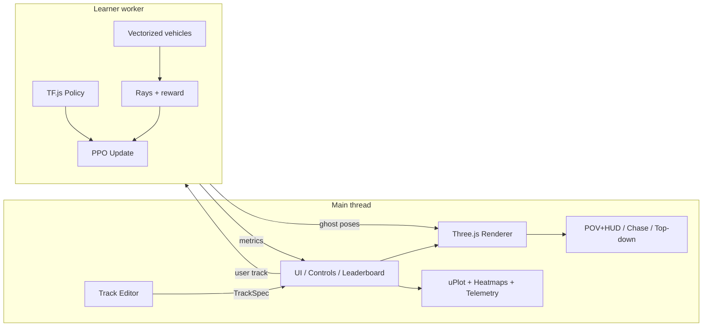
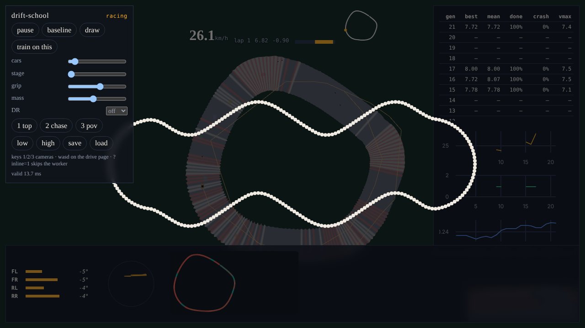
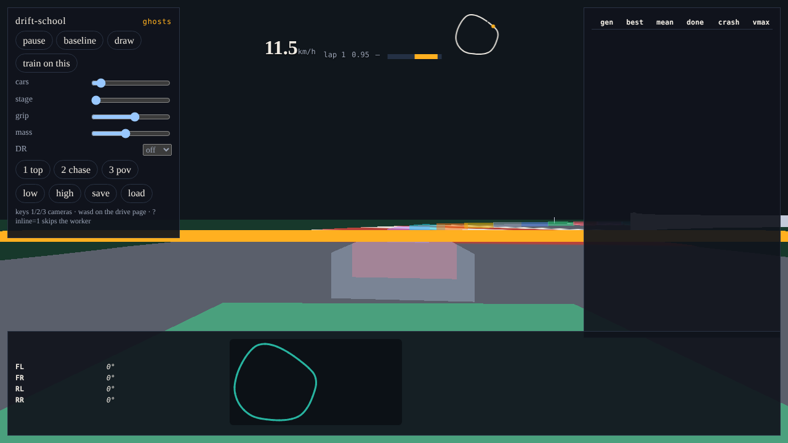
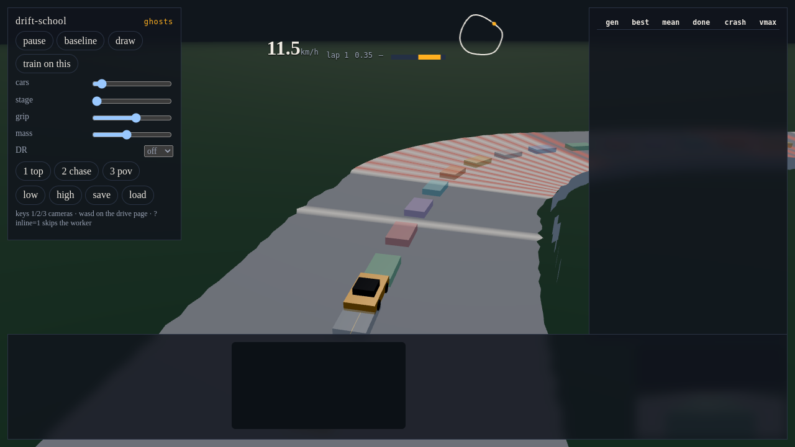

# drift-school

Draw a racetrack with the mouse and watch small RC cars learn to race it in the browser. Tire slip, suspension, and weight transfer are simulated in TypeScript. A PPO policy trains beside a pure-pursuit teacher. Rendering is Three.js, WebGPU when the browser allows it and WebGL2 otherwise. Nothing here needs a server.

## Setup

```bash
npm install
npm run dev
```

Open http://127.0.0.1:5173 . The dev server sends `Cross-Origin-Opener-Policy: same-origin` and `Cross-Origin-Embedder-Policy: require-corp`. GitHub Pages cannot set those headers, so `public/coi-serviceworker.js` rewrites responses and reloads once. The Pages workflow uses `base: './'` and no repository secrets.

```bash
npm test          # unit + perf budgets
npm run lint
npm run build
npm run test:e2e  # Playwright. Needs a display stack or Chromium's software GL.
npm run eval      # SPEC section 3 acceptance table (about 13 min; --quick, --only=stage0,matrix,hotswap,fps,physics)
```

Keyboard driving, with Rapier walls, is at http://127.0.0.1:5173/dev/drive.html .

## Controls

| Input | Action |
| --- | --- |
| 1 / 2 / 3 | Top-down, chase, in-car POV |
| Draw | Freehand overlay. Release to simplify (RDP + Chaikin). Auto-closes if the ends are within 1 m |
| Train on this | Hot-swap. 70% drawn track, 30% procedural, entropy 0.02, learning rate 3e-4. Base checkpoint is forked |
| Pause, baseline | Freeze learning, or watch pure pursuit |
| Stage, grip, mass, DR | Curriculum override and domain-randomization knobs |
| Save / load | Checkpoint in memory and IndexedDB |
| Leaderboard row | Replay that generation's stored pose tape |
| WASD or arrows | Only on the drive page |

A track in the URL hash is `deflate` of quantized millimeters. Round-trip error is at most 1 mm.

Query flags: `?view=ghosts` (64 cars, no training), `?cam=pov`, `?inline=1` (train on the main thread), `?quiet=1`, `?quality=high`.

## Architecture



The learner worker owns both the rollout and the update. `src/workers/env.worker.ts` can step a `VecEnv` on its own. There is not a four-worker SharedArrayBuffer pool.

Physics runs at 500 Hz inside each 50 Hz control step. Observations are 48 floats (21 rays plus speed, slip, and track-relative features). Actions are steer and throttle in [-1, 1].

## What the learning actually does

Stage 0 does not reliably learn laps from a random Gaussian policy on CPU TF.js (about 700 steps/s here, and the cars crash). The recipe (`src/rl/recipe.ts`) distils the pure-pursuit car with DAgger, stage by stage, under domain randomization and mixed surfaces, then runs a short validation-gated PPO phase. Nearly all of the driving skill comes from that imitation; PPO moves lap time by about 1% at this budget (`NOTES/rl.md`). Treat the reward chart as fine-tuning, not as proof of from-scratch learning inside three minutes. Hot-swap fine-tuning on a drawn track is also DAgger interleaved with PPO (`NOTES/swap.md`).

`tRef` on a generated track is an analytic curvature speed profile. The pure-pursuit car is simulated separately and does finish stage 0–2 tracks.

Ghost cars in the vectorized env bounce off wall polylines with a restitution impulse. The drive page is the path that calls Rapier.

## Pictures








`docs/media/race.gif` is a short top-down capture when the headless browser produced a non-blank frame.

## Layout

`src/shared` contracts, `src/track` generator, `src/sim` vehicle and env, `src/rl` PPO, `src/editor` drawing and URL hash, `src/viz` Three.js, `src/ui` charts and leaderboard, `src/workers` learner and env.

## License

MIT. See [LICENSE](LICENSE).
