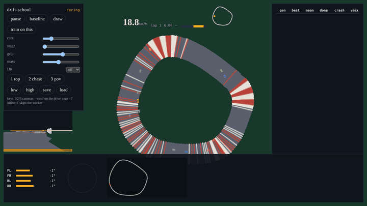
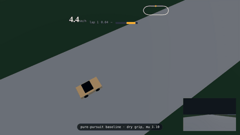
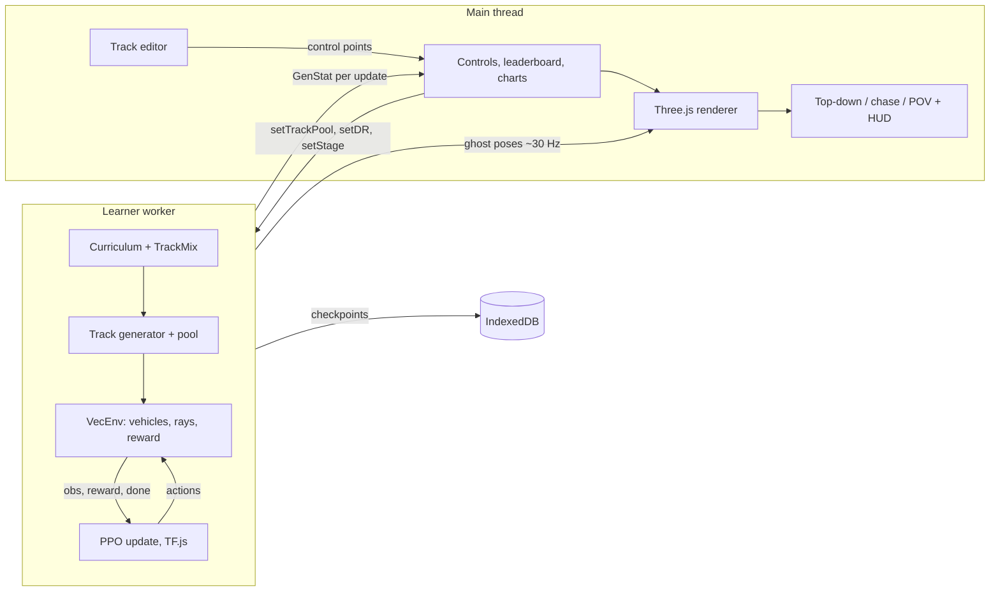

# drift-school

**Draw a racetrack with your mouse and watch a swarm of tiny RC cars learn to drive it. In your browser. No server.**

[](https://github.com/alexnieves-cs/drift-school/actions/workflows/ci.yml)
[](LICENSE)



**[Live demo](https://alexnieves-cs.github.io/drift-school/)** · [Architecture](docs/ARCHITECTURE.md) · [Benchmarks](docs/BENCHMARKS.md) · [Acceptance status](docs/ACCEPTANCE.md) · [Spec](SPEC.md) · sibling project: [frontier-fly](https://github.com/alexnieves-cs/frontier-fly)

The cars run on a vehicle model written for this project: Pacejka tires, four spring-damper suspensions with real weight transfer, a motor curve and a rate-limited steering servo, stepped at 500 Hz. A PPO policy trains in a Web Worker beside it, rendering is Three.js (WebGPU when the browser offers it, WebGL2 otherwise), and everything is deterministic from a seed. Draw a loop, press **Train on this**, and the new track is hot-swapped into the running training session without touching the weights.

The clip above is a timelapse of the live app: a track drawn with the mouse, validated in under 25 ms, swapped into training, then lapped. Its source is in [`scripts/record-demos.mjs`](scripts/record-demos.mjs).

## What's in it

| | |
| --- | --- |
| **Vehicle physics** | 1:10 RC car. Pacejka-lite tires with load-sensitive grip and a friction ellipse, 4-corner suspension, weight transfer, 4WD or RWD, motor lag. 0.024 ms per control step. |
| **Procedural tracks** | A seeded generator (jittered hull, displacement, Catmull-Rom spline) in five difficulty stages. Same seed, same track, byte for byte. |
| **Draw-a-track editor** | Freehand stroke, simplified and smoothed, checked live for self-intersection, tight radius, short length and overlap, with the reason and the location. |
| **Hot-swap and fine-tune** | 70% your track, 30% procedural, a temporary entropy bump, and a forked checkpoint so the base model survives. |
| **Live training view** | 64 instanced ghost cars, a generation leaderboard you can click to replay, uPlot charts, wheel-load telemetry and a speed heatmap. |
| **Three cameras** | Top-down, wall-aware chase, and an in-car POV with a HUD. Keys 1, 2, 3. |
| **Shareable tracks** | A drawn track lives in the URL hash, quantized to millimetres. |
| **Headless sim** | The sim, tracks and RL code never import Three.js or the DOM, and ESLint enforces it. `npm run eval` trains and scores in Node. |

## The five demo moments, and what the clips show

The [spec](SPEC.md) lists five moments to show off. This table says which are real today. Clips are made by a script from the running app, and the numbers behind them are in [docs/BENCHMARKS.md](docs/BENCHMARKS.md).

| # | Moment | Clip | Status |
| --- | --- | --- | --- |
| 1 | 64 cars learn to lap | [GIF](docs/media/demo-race.gif) · [MP4](docs/media/demo-race.mp4) | **Partly.** 64 cars train live and lap a generated track. They do not spin out first and then learn: the policy starts as a clone of the pure-pursuit controller (see below). |
| 2 | Generation-best lap time drops | same clip | **Partly.** In the recorded run the best lap per update fell from a median of 9.0 s (first five lap-finishing updates) to 6.2 s (last five) over about 28 updates on a short stage-0 track. The 40 s to 14 s story in the spec is not shown. |
| 3 | Draw a hairpin, hot-swap, re-learn | [GIF](docs/media/demo-draw-hairpin.gif) · [MP4](docs/media/demo-draw-hairpin.mp4) | **Hot-swap yes, re-learning no.** The drawn track is validated, swapped in with the weight hash unchanged, and the cars lap it. The in-app readout shows 100% completion on it with no crash-and-relearn phase: the cloned policy drives it from the start. |
| 4 | In-car POV, countersteer drift | [GIF](docs/media/demo-hairpin-pov.gif) · [MP4](docs/media/demo-hairpin-pov.mp4) | **POV yes, drift no.** The POV camera and HUD are real, driving a real vehicle model through a hairpin. A controlled drift with countersteer on a track is not demonstrated. |
| 5 | Dry to ice, brakes earlier, still finishes | [POV](docs/media/demo-hairpin-pov.gif) · [chase](docs/media/demo-hairpin-chase.gif) | **Real, with the baseline driver.** The pure-pursuit controller laps the same hairpin dry (16.4 s) and on ice (22.6 s, top speed 5.0 vs 5.6 m/s). The learned policy is not driving in this clip. |



## Benchmarks

Every number comes from a script in this repository. [docs/BENCHMARKS.md](docs/BENCHMARKS.md) has the commands, the machine, and the rows that are not measured yet.

| What | Result | Script |
| --- | --- | --- |
| Stage-0 lap completion, held-out seeds, headless | 100% (16/16) in 5 s | `npm run eval` |
| Vehicle step, 10 substeps | 0.024 ms median (budget 0.15 ms) | `npm run perf` |
| Vectorized env, 64 cars, one process | about 11,000 car-steps/s | `npm run perf` |
| Track generation / validation | 1.2 ms / 0.9 ms median | `npm run perf` |
| Pure-pursuit lap, hairpin, dry / ice | 16.4 s / 22.6 s | `scripts/record-demos.mjs hairpin` |
| Hot-swap onto a drawn S-curve: weights unchanged, completion after 2 min, no forgetting | hash equal; 100% (16/16), zero-shot 100%; procedural 100% retained | `npm run eval` |
| Surface x randomization matrix (8 seeds x asphalt, carpet, dirt x DR low, high) | 99% (143/144) | `npm run eval` |
| 64 ghost cars at 50 fps | not measured, needs a GPU (software GL gives about 7 fps) | `npm run eval` prints `skip` |

Measured in a 4-vCPU Linux container with software rendering. Frame rate on a real GPU is not in this table. The full line-by-line acceptance status, including what is weak evidence, is in [docs/ACCEPTANCE.md](docs/ACCEPTANCE.md).

## How training works



1. **Observation.** 48 floats: 21 range rays, body-frame speeds, slip angles, wheel-load shares, the previous action, and track-relative features (offset, heading error, curvature ahead). Layout in [`src/sim/OBS_LAYOUT.md`](src/sim/OBS_LAYOUT.md).
2. **Action.** Steer and throttle in [-1, 1]. Negative throttle brakes, then reverses.
3. **Reward.** Progress along the centerline, lap and lap-time bonuses, minus penalties for leaving the track, hitting walls, jerky inputs, going the wrong way and wasting time.
4. **Imitation first, then PPO.** From-scratch PPO at the throughput of CPU TF.js did not learn laps in minutes. So the trainer first clones the pure-pursuit controller onto the policy, warms up the critic, then runs PPO (clip 0.2, GAE, Adam 3e-4) on top. Read the reward curve after that as fine-tuning, not as learning from nothing.
5. **Curriculum.** Five stages, from a wide oval to narrow hairpins, with 20% replay of earlier stages.
6. **Hot-swap.** "Train on this" queues the drawn track behind the running update, resets the environments onto a 70/30 pool of your track and procedural tracks, and forks the checkpoint. The trainer throws if the weight hash changes across a swap.

More detail in [docs/ARCHITECTURE.md](docs/ARCHITECTURE.md).

## Run it

Node 22 and npm.

```bash
npm ci
npm run dev       # http://127.0.0.1:5173
```

```bash
npm test          # unit tests
npm run lint
npm run build
npm run eval      # the acceptance table from SPEC section 3
npm run perf      # warmed-up throughput numbers
npm run bench     # perf budget checks
npm run test:e2e  # Playwright, needs a WebGL-capable Chromium
```

The dev server sends the COOP and COEP headers that `SharedArrayBuffer` needs. GitHub Pages cannot, so `public/coi-serviceworker.js` rewrites responses and the page reloads once.

| Input | Action |
| --- | --- |
| 1 / 2 / 3 | Top-down, chase, in-car POV |
| draw | Freehand overlay. Release to simplify and smooth. A stroke closes itself if its ends are within 1 m |
| train on this | Hot-swap your track into training |
| pause, baseline | Freeze learning, or watch the pure-pursuit car |
| stage, grip, mass, DR | Curriculum override and domain randomization |
| save / load | Checkpoint in IndexedDB |
| leaderboard row | Replay that generation's best lap |

Useful URLs: `/?cars=64` for the 64-car view, `/?view=ghosts` for a scripted ghost lap with no training, `/dev/drive.html` to drive with WASD, and `/dev/showcase.html?manual=1&cam=pov` for the baseline-on-ice stage the clips were recorded from. A track you drew is in the URL hash.

## Honest limits

- Training does not start from scratch. It starts from a pure-pursuit clone, so "learned to race" here means "fine-tuned a cloned driver", and the stage-0 completion above is mostly the clone's doing.
- Drift is not demonstrated on a track. In the physics test, with rear grip scaled to 0.8 the car holds a sustained slide (42 to 46 degrees of rear slip) and recovers when the steering is released. With rear grip at 0.5 it spins out. That is a slide, not a controlled drift, and no controller here drives one around a corner.
- In the multi-car view the cars train on a pool of four generated tracks but only one track is drawn, so some ghosts look like they are driving off the road. They are on a track you cannot see.
- Throughput is one process. The spec's four-worker `SharedArrayBuffer` farm and 20k steps/s are not built.
- The renderer has WebGPU and WebGL2 paths and a Low and a High preset. In headless software GL the High preset rendered a black frame, so every clip uses Low. GTAO, TAA, cascaded shadows and bloom from the spec are not implemented.
- The ghost-car frame rate is not measured, because the only browser here has no GPU. The eval table's matrix and hot-swap rows run in Node with the cloned-then-fine-tuned policy, so they show it holds up across surfaces and swaps, not that it learned them.

## Credits

- Built by [Alex Nieves](https://github.com/alexnieves-cs) with Claude Code.
- Sibling project: [frontier-fly](https://github.com/alexnieves-cs/frontier-fly), the in-browser drone explorer whose stack and structure this reuses.
- Full dependency and technique credits are in [CREDITS.md](CREDITS.md). Main libraries: [three.js](https://threejs.org) (MIT), [TensorFlow.js](https://www.tensorflow.org/js) (Apache-2.0), [Rapier](https://rapier.rs) (Apache-2.0), [uPlot](https://github.com/leeoniya/uPlot) (MIT), [fflate](https://github.com/101arrowz/fflate) (MIT).
- The cross-origin-isolation service worker follows the approach of [coi-serviceworker](https://github.com/gzuidhof/coi-serviceworker).
- Nothing in the repository is third-party art. The track, car and HUD geometry are drawn in code.

## License

MIT. See [LICENSE](LICENSE). Contributions are welcome: see [CONTRIBUTING.md](CONTRIBUTING.md).
