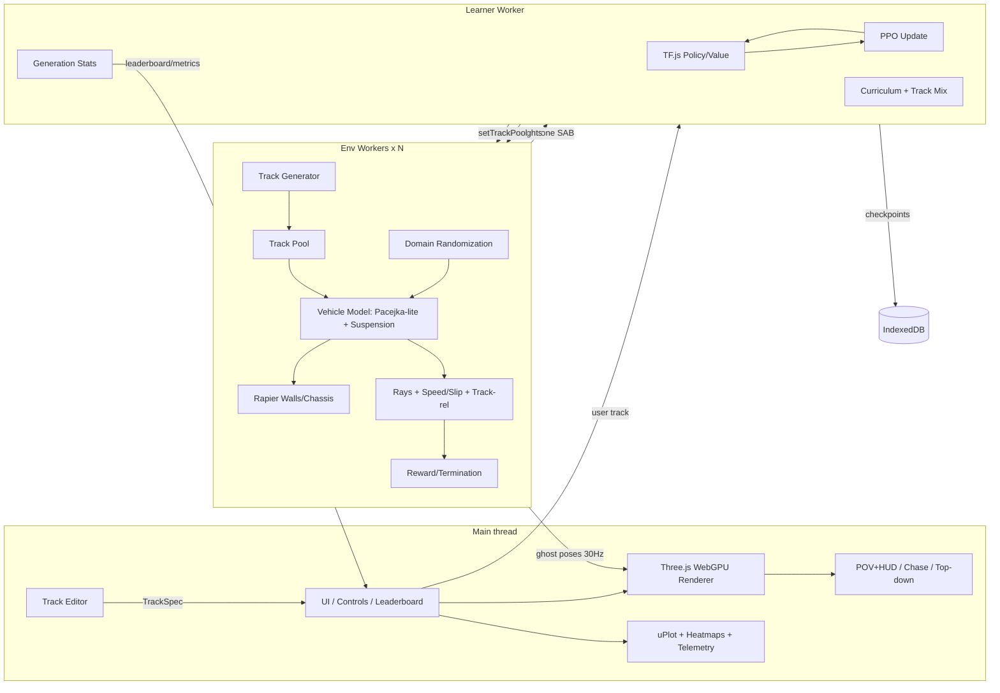

# RC Racer — Spec

Personal project (Alex Nieves). In-browser self-driving RC car: a small neural net learns to race procedurally generated tracks, and users can draw their own track and watch the policy adapt live. Reuses the frontier-fly stack and architecture.

---

## 1. Spec

### Goals
- Train a racing policy fully in-browser (no server), visible live with dozens of ghost cars.
- Realistic RC handling: tire slip and grip, drift, suspension, weight transfer.
- Seeded procedural tracks plus a draw-a-track editor that hot-swaps into training and fine-tunes.
- Deterministic and reproducible (seed → track + DR + init). Shareable URL (track + checkpoint).
- Sim decoupled from rendering, so training runs headless and fast.

### Non-goals
- Sim-grade vehicle dynamics (full Pacejka MF6.x, tire thermals, drivetrain FEM).
- Camera-pixel driving policy (MVP). Multiplayer/backend. Real-car transfer.
- Racing against humans in real time (stretch at most).

### Demo moments
1. 64 ghost cars spin out at corner 1 → minutes later a pack laps cleanly.
2. Leaderboard ticks up: the generation-best lap time drops from 40 s to 14 s.
3. Draw a hairpin with the mouse → the track is validated and smoothed, then hot-swapped. The cars crash on it, then re-learn it in under 2 minutes.
4. In-car POV through a chicane: the car drifts the final corner with countersteer.
5. Randomized grip (dry → "ice") at the same track: the policy brakes earlier and still finishes.

### Tech stack (reuse frontier-fly; recommended in **bold**)
| Area | Pick | Tradeoff |
|---|---|---|
| Render | **Three.js r16x+ WebGPURenderer** (WebGL2 fallback) | Same as frontier-fly; Babylon is the swap-in backup behind the `Renderer` interface. Godot/Unity was rejected (bundle size, training bridge, runtime procedural meshing). |
| Physics | **Custom vehicle model in TS** + **Rapier** for chassis rigid body and wall collisions | Rapier's raycast vehicle is too arcade-like for slip/drift. Our own tire + suspension model is deterministic, cheap, and DOM-free. |
| NN / RL | **TF.js PPO** in a learner worker; env workers vectorized | Proven in frontier-fly. ONNX Runtime Web is for inference-only "play" mode (stretch). |
| Build | **TypeScript + Vite**, Vitest, Playwright, Comlink, SharedArrayBuffer (COOP/COEP) | — |
| Charts | **uPlot** | Streaming curves. |
| Editor | Canvas2D/SVG overlay on the top-down view; **centripetal Catmull-Rom** → resampled arc-length spline | Simple, with no extra dependencies. |
| Shared code | Copy (not a package dep) `rng.ts`, worker pool, PPO, renderer base from frontier-fly into `src/shared` / `src/rl` | Avoids coupling the two repos; extracting a shared lib can come later. |

### Car physics (RC 1:10 scale)
- **Chassis:** 6-DoF rigid body. Mass 1.2–2.5 kg, wheelbase 0.26 m, track width 0.2 m, CG height 3–6 cm, yaw inertia from a box approximation.
- **Suspension:** 4 independent spring-dampers along the wheel-down raycast. k, c, travel 15–25 mm, and anti-roll bar stiffness are parameters. Per-wheel normal load Fz comes from spring force, which gives **weight transfer** for free: longitudinal under braking/accel, lateral in corners.
- **Tires: Pacejka-lite**
  - Slip angle α = atan2(v_lat, |v_long|); slip ratio κ = (ωr − v_long)/max(|v_long|, ε). A low-speed blend to a damped model below 0.5 m/s avoids singularities.
  - F = D·sin(C·atan(B·x − E·(B·x − atan(B·x)))), with D = μ·Fz (load-sensitive μ: μ = μ0·(1 − k_load·Fz/Fz0)).
  - Combined slip: friction ellipse scaling of Fx and Fy (√((Fx/Fxmax)² + (Fy/Fymax)²) ≤ 1).
  - Separate B, C, E per axle. Rear-biased lower grip enables **drift**: oversteer with countersteer recovery is learnable.
- **Drivetrain:** brushless motor torque curve (torque falls linearly to max RPM), first-order lag τ 30 ms, 4WD with front/rear split (or RWD variant), open/limited-slip diff lite, brake torque per axle, optional handbrake (rear lock).
- **Steering:** servo rate limit (≈ 0.1 s per 60°), max angle 25–30°, Ackermann geometry.
- **Aero:** quadratic drag + rolling resistance.
- **Integration:** semi-implicit Euler at 500 Hz physics, 50 Hz control, policy at 25 Hz with action hold. Wall contacts go through Rapier (chassis convex hull vs wall colliders) with restitution 0.3.
- **Randomized physical properties (DR, per episode):** mass ±25%, CG height ±30%, μ0 0.5–1.4 (surface types: asphalt, carpet, dirt, "ice" 0.3 in stretch), B/C/E ±15%, spring/damper ±25%, motor torque ±20%, servo rate ±20%, steering offset ±2°, latency 0–2 ticks, sensor noise ×[0.5, 2].
- **Validation tests:** steady-state circle (understeer gradient sign matches setup); step steer (yaw-rate overshoot bounded); a straight-line launch reaches top speed within ±5% of the analytic value; no NaN over 1e6 random steps; same seed + same actions → identical trajectory.

### Sensors / observation (≈ 48 floats)
- 21 ray distances in a forward 200° fan (wall/track-edge hits), max 6 m, normalized, noise σ 1 cm, 1% dropout.
- Speed: v_long, v_lat (body frame); yaw rate; slip angle front/rear (2); mean rear slip ratio (1).
- Previous action (2); steering angle actual (1); wheel load fraction front/rear (2, a "feel" signal).
- Track-relative (from the spline, as a cheap "GPS"): lateral offset from the centerline normalized by half-width, heading error sin/cos, and curvature look-ahead at 5 points (0.5–4 m ahead). Ablation flag: rays-only mode for a harder, purer demo.
- Total: 21 + 6 + 3 + 2 + 2 + 3 + 5 + 1 (time-left) ≈ 43–48. `OBS_DIM` is fixed in contracts and the order is documented in `sim/OBS_LAYOUT.md`.

### Action space
- Continuous 2-D [steer, throttle/brake] ∈ [-1, 1] (tanh-Gaussian). Negative throttle = brake, then reverse after stopping. Optional 3rd dim: handbrake (stretch).
- Policy: MLP 48→128→128 (tanh) → mean(2) + logStd. Separate value head. Small enough for 64+ cars per worker batch.

### Reward
- **Progress:** +Δs (arc length along the centerline, in m) × 1.0. Clipped against shortcut exploits (Δs > max-plausible is ignored).
- **Lap:** +10 per completed lap, + bonus 20·(t_ref / t_lap − 1) when beating a reference/best lap time.
- **Off-track:** −0.5/step with ≥2 wheels outside the edges, terminate after 1.5 s off-track.
- **Wall:** −5 on impact (scaled by impact speed), −0.2/step while in contact.
- **Smoothness:** −0.02·‖a_t − a_{t−1}‖², −0.005·steer² at high speed (prevents weaving).
- **Wrong way:** −1/step if heading error > 120°; terminate after 2 s.
- **Time:** −0.01/step. Reward normalized with running std.

### Termination
- N laps completed (MVP: 3), or step cap (scaled by track length / 1.5 m/s).
- Off-track > 1.5 s, wrong way > 2 s, stuck (speed < 0.2 m/s for 3 s), flip (roll > 80°).

### Curriculum
| Stage | Tracks / physics | Promote when |
|---|---|---|
| 0 | Wide oval, high grip, no DR | ≥ 80% episodes finish 1 lap |
| 1 | Gentle procedural loops, width 1.5 m | lap completion ≥ 80% |
| 2 | Tighter corners, width 1.0 m, mild DR | completion ≥ 75%, lap time < 1.3 × reference |
| 3 | Hairpins, chicanes, width 0.8 m, full DR, mixed surfaces | completion ≥ 70% |
| 4 | Racing: lap-time bonus weighted up, low-grip surfaces, drift-favorable setups | best-lap improvement plateaus |
- 20% replay of prior stages. Reference lap time t_ref comes from a pure-pursuit + speed-profile baseline controller per track (computed at generation time). It's also a demo comparison car.

### Seeded track generator
- Seeded PRNG (sfc32, `fork(label)`), no `Math.random`.
- Method: sample K (8–20) points around a center with jittered radius/angle → convex hull + random midpoint displacement (inward/outward) → push apart points closer than d_min → enforce max turn angle per stage → centripetal Catmull-Rom closed spline → arc-length resample at 0.1 m.
- Width profile per segment (stage range), widening slightly at hairpins. Optional elevation (stretch, small banking/bumps).
- Surfaces: per-segment μ zones (stretch: puddles, dirt patches).
- Outputs `TrackSpec` (see contracts): centerline samples (pos, tangent, normal, curvature, s), left/right edges, wall polylines (offset + margin), start/finish line, checkpoint gates every 2 m, plus t_ref.
- Same validity checks as the editor (below). Invalid → retry with seed+1.

### Draw-a-track editor
- **Input:** freehand mouse/touch stroke on the top-down canvas, or click-to-place control points. Close the loop automatically if the end is within 1 m of the start.
- **Processing:** Ramer–Douglas–Peucker simplification → Chaikin ×2 smoothing → centripetal Catmull-Rom → arc-length resample. A curvature limiter (min radius ≥ 0.6 × car turning radius) relaxes offending points iteratively. Drag points to edit, with a width slider and a per-segment surface brush.
- **Validity checks (live, with red highlights):** closed loop; no self-intersection of either edge (segment sweep); min radius; min straight length near the start line; total length 15–150 m; edges don't overlap other parts of the track (min separation = width + 0.3 m); fits in bounds. Each failure says exactly where and why.
- **Hot-swap into training:**
  1. On "Train on this", the editor emits a `TrackSpec` (and baseline t_ref) → learner broadcasts `{type:'setTrackPool', tracks, mix}`.
  2. Env workers finish their current episode, then reset onto the new pool. No restart, no reload of weights.
  3. **Fine-tune mode:** the pool becomes 70% the user track + 30% replay of procedural tracks (prevents forgetting). Entropy coefficient gets a temporary bump (0.01 → 0.02 for 20 updates), LR warm restart to 3e-4. The checkpoint is forked to `user-<hash>` so the base model is preserved.
  4. UI shows "adaptation" metrics: completion rate and best lap on the user track vs updates since swap, plus the zero-shot result (first 64 episodes before any update).
  5. Save/share: track JSON plus checkpoint in IndexedDB. URL hash encodes compressed control points.

### Live training viz
- **Ghost cars:** the showcase worker streams poses of up to 64 cars (instanced meshes, semi-transparent; best car opaque with a trail). Color by return percentile or by policy version. Toggle: "this generation" vs "last 5 gens' best laps" as replayed ghosts.
- **Leaderboard of generations:** table of PPO update index ("gen"), best lap, mean lap, completion %, crash rate, top-speed, plus a sparkline. Click a row to replay that gen's best lap as a ghost against the current policy.
- **Charts (uPlot):** mean/max episode return, lap time (best/median), completion %, off-track & wall rate, entropy, KL, value loss, steps/s.
- **Track heatmaps:** speed along the racing line per gen (color the centerline), crash/off-track hotspot dots, and a slip-angle overlay to show where it drifts.
- **Telemetry panel (selected car):** speed, steer, throttle, slip angles, wheel loads (4 bars), g-g diagram.
- Controls: pause/resume, speed (render-throttled vs max train), car count, stage override, DR sliders (grip, mass), checkpoint save/load, baseline car toggle.

### Cameras
- **In-car POV:** bumper/cockpit cam, 90° FOV, slight vibration from suspension travel, motion blur. HUD: speed, lap/lap time/delta to best, gear-less RPM bar, steer/throttle bars, mini-map.
- **Chase:** spring-damped follow, with a collision-aware boom (raycast against walls) and a look-ahead offset in corners.
- **Top-down:** orthographic full-track view, used for the editor and by default with many ghost cars. Zoom/pan, follow-selected toggle.
- Also a trackside TV cam (stretch): auto-switches to the nearest of N track cameras.
- Hotkeys 1/2/3(/4), with picture-in-picture POV. Cameras live only in the renderer.

### Graphics (reuse frontier-fly renderer base)
- PBR: asphalt/carpet/dirt materials with seeded variants, curbs on high-curvature edges (auto-generated), walls/barriers, tire marks decal pass driven by slip (an instanced ribbon).
- Lighting: sun + sky with time of day (reuse), CSM shadows, GTAO, bloom, AgX + auto-exposure, TAA. Low (WebGL2) / High (WebGPU) presets.
- Dust/smoke particles from high rear slip (stretch).

### Architecture


### Perf budget (mid laptop, Chrome)
- Car env step (10 physics substeps at 500 Hz + 21 rays + spline lookup) < 0.15 ms → ≥ 6k steps/s per worker. Vectorized 64 cars per worker.
- Total ≥ 20k env-steps/s on 4 workers.
- PPO: 64 envs × 128 steps × N workers per update, 4 epochs, minibatch 1024, under 2 s/update (WebGL backend).
- Render: 64 instanced ghost cars at High ≥ 50 fps; Low ≥ 60 fps; the ghost stream is 30 Hz, interpolated.
- Editor: validity check + spline < 16 ms per edit (live). Track gen < 20 ms.
- Hot-swap latency: user clicks "Train" → all envs on the new track in < 1 episode (≤ 15 s), with UI feedback < 100 ms.
- Learning: stage 0 laps within 3 min; stage 2 within 15 min; zero-shot completion on a user track ≥ 40% after stage 3, ≥ 80% after a 2-min fine-tune.

---

## 2. Milestones

### MVP (~2 weeks)
- **M0 Scaffold (Day 1):** Vite/TS/Vitest/Playwright, `shared/` contracts, RNG, worker pool, and PPO copied from frontier-fly, COOP/COEP.
- **M1 Track + car (Days 2–5):** seeded track generator + validity checks, vehicle model (Pacejka-lite, suspension, weight transfer, drivetrain, steering), Rapier walls, keyboard drive mode, basic top-down render.
- **M2 RL (Days 6–9):** env API, sensors, reward/termination, vectorized env workers, PPO learner, stage 0–2 curriculum, reward curve. Baseline pure-pursuit car + t_ref.
- **M3 Viz (Days 10–12):** 64 ghost cars (instanced), leaderboard of generations, charts, chase + top-down cameras, checkpoint save/load.
- **M4 Editor + hot-swap (Days 13–14):** draw/smooth/validate, "Train on this" hot-swap + fine-tune mode, adaptation metrics, URL share.

### MVP+ (Week 3)
- **M5 Realism:** full DR (properties + surfaces), stage 3–4, drift tuning, in-car POV + HUD, WebGPU PBR/shadows/post, tire marks, telemetry panel, g-g plot.

### Stretch
- Handbrake action and drift-scoring mode (reward for controlled slip angle).
- Racing other agents: multi-car collisions, overtaking reward, self-play league.
- Elevation, banking, jumps, mixed-surface puddles; dust/smoke particles; trackside TV cams.
- Rays-only policy vs track-relative-obs ablation, displayed side by side.
- Camera-pixel policy (low-res CNN) with lighting DR.
- Human vs AI: user drives with keyboard/gamepad against the best ghost.
- ONNX Runtime Web play mode; shared track gallery (local only, no backend).

---

## 3. Acceptance tests

- **M0:** `tsc --noEmit` clean; RNG determinism; worker ping round-trip; dev server serves COOP/COEP headers.
- **M1:**
  - Track gen: 1000 seeds × all stages valid; same seed → byte-identical TrackSpec; < 20 ms.
  - Validity: fixture suites of known-bad tracks (self-intersecting, too tight, too short, overlapping edges) are each rejected with the right reason code. Known-good fixtures pass.
  - Car: circle test understeer sign; step-steer overshoot bound; launch top speed ±5%; determinism; 1e6 random steps without NaN; step < 0.15 ms.
  - Weight transfer: braking from 5 m/s increases front Fz share ≥ 10%.
  - Drift: low rear grip + throttle in a corner produces rear slip angle > 15° and recovers with countersteer under the scripted controller.
- **M2:** PPO solves the toy env (copied test); headless e2e shows stage 0 lap completion ≥ 80% within 3 min; baseline car finishes all generated stage 0–2 tracks.
- **M3:** 64 ghost cars ≥ 50 fps; leaderboard rows equal the number of updates; clicking a row replays a deterministic ghost lap; no main-thread long tasks > 50 ms.
- **M4:** draw an S-curve via Playwright mouse path → valid → hot-swap: all envs report the new track id within 15 s; weights unchanged at swap (hash equal); after 2 min completion on that track ≥ 80%; procedural-track completion stays ≥ 90% of its pre-swap value (no forgetting); the URL hash round-trips the track.
- **M5:** eval matrix (seeds × {asphalt, carpet, dirt} × DR {low, high}) completion ≥ 70%; POV/chase/top-down switch < 1 frame; HUD values match state; High-preset fps budget met.

---

## 4. Claude Code Implementation Guide (parallel subagents, Max 20x)

### Workflow
- One **lead** session owns `src/shared/`, merges, and runs gates. Subagents each work in their own **git worktree** + branch:
  ```bash
  git worktree add ../rc-racer-trackgen -b feat/trackgen
  git worktree add ../rc-racer-car      -b feat/car
  git worktree add ../rc-racer-rl       -b feat/rl
  git worktree add ../rc-racer-viz      -b feat/viz
  ```
- Run 4–5 Claude Code sessions concurrently (one per worktree). The lead merges into `main` after each stream's tests pass, then the others rebase.
- Contract changes go via `CONTRACT_REQUESTS.md`. Only the lead edits `src/shared/`.
- ESLint `no-restricted-imports`: `three`, DOM globals, and `ui/` are banned in `gen/`, `sim/`, `rl/`, `workers/env*`.
- Each agent ends by running `npm test -- <its dir>` and writing `NOTES/<stream>.md` (what was done, open issues).

### Repo layout
```
src/
  shared/      types.ts, rng.ts, constants.ts, messages.ts         # contracts (lead only)
  track/       generate.ts, spline.ts, validate.ts, sample.ts, baseline.ts (pure-pursuit + t_ref)
  editor/      editor.ts, stroke.ts (RDP+Chaikin), handles.ts, overlays.ts, share.ts
  sim/         car/{tire.ts, suspension.ts, drivetrain.ts, steering.ts, vehicle.ts}, world.ts (Rapier),
               sensors.ts, reward.ts, env.ts, vecEnv.ts, dr.ts, OBS_LAYOUT.md
  rl/          model.ts, ppo.ts, buffer.ts, normalize.ts, curriculum.ts, trackMix.ts, checkpoint.ts, genStats.ts
  workers/     env.worker.ts, learner.worker.ts, pool.ts
  viz/         renderer.ts (interface), three/{scene,materials,track-mesh,cars-instanced,tiremarks,post,sky}.ts, interp.ts
  viz/cameras/ pov.ts, chase.ts, topdown.ts, hud.ts
  ui/          app.ts, controls.ts, charts.ts, leaderboard.ts, telemetry.ts, heatmaps.ts
  main.ts
tests/         unit per dir, fixtures/{tracks-good,tracks-bad}/*.json, e2e/*.spec.ts, perf/*.bench.ts
```

### Interface contracts (`src/shared/types.ts`)
```ts
export interface TrackSample { x: number; z: number; tx: number; tz: number; nx: number; nz: number;
  curvature: number; s: number; halfWidth: number; mu: number }
export interface TrackSpec { id: string; seed?: number; source: 'gen'|'user'; samples: TrackSample[];
  length: number; leftEdge: Float32Array; rightEdge: Float32Array; walls: Float32Array[];
  startIndex: number; tRef: number }
export interface TrackGenParams { seed: number; stage: number }
export function generateTrack(p: TrackGenParams): TrackSpec;            // track/generate.ts, pure
export type InvalidReason = 'open'|'selfIntersect'|'minRadius'|'tooShort'|'tooLong'|'edgeOverlap'|'bounds'|'startStraight';
export interface Validation { ok: boolean; issues: { reason: InvalidReason; at: [number, number] }[] }
export function validateTrack(controlPts: Float32Array, halfWidth: number): Validation;
export function buildTrackFromPoints(controlPts: Float32Array, opts: { halfWidth: number; mu?: number }): TrackSpec;

export interface CarParams { mass: number; cgHeight: number; wheelbase: number; track: number; yawInertia: number;
  tire: { front: PacejkaLite; rear: PacejkaLite; mu0: number; loadSens: number };
  susp: { k: number; c: number; travel: number; arb: number }; motor: { torque: number; maxRpm: number; tau: number };
  steer: { maxAngle: number; rate: number; offset: number }; drive: '4wd'|'rwd'; split: number }
export interface PacejkaLite { B: number; C: number; E: number }
export interface CarState { pos: [number,number,number]; quat: [number,number,number,number];
  vel: [number,number,number]; yawRate: number; steer: number; wheelOmega: Float32Array; // 4
  wheelLoad: Float32Array; slipAngle: Float32Array; slipRatio: Float32Array; s: number; lap: number; lapTime: number }

export const OBS_DIM = 48, ACT_DIM = 2;
export interface EpisodeConfig { stage: number; car: CarParams; noiseScale: number; latencyTicks: number; trackId: string }
export interface StepResult { obs: Float32Array; reward: number; done: boolean; truncated: boolean;
  info: { progress: number; lapDone: boolean; lapTime?: number; offTrack: boolean; wallHit: boolean } }
export interface VecEnv { readonly n: number; reset(tracks: TrackSpec[], cfgs: EpisodeConfig[]): Float32Array; // n*OBS_DIM
  step(actions: Float32Array): { obs: Float32Array; rew: Float32Array; done: Uint8Array; trunc: Uint8Array; infos: StepResult['info'][] };
  poses(): Float32Array /* n*7 pos+quat */ }
export interface Policy { act(obs: Float32Array, n: number): { action: Float32Array; logp: Float32Array; value: Float32Array };
  getWeights(): ArrayBuffer[]; setWeights(w: ArrayBuffer[]): void }
export interface GenStat { gen: number; bestLap: number|null; meanLap: number|null; completion: number;
  crashRate: number; topSpeed: number; meanReturn: number; trackId: string }
export interface Renderer { loadTrack(t: TrackSpec): void; updateCars(poses: Float32Array, n: number, highlight: number): void;
  setCamera(m: 'pov'|'chase'|'topdown'): void; setQuality(q: 'low'|'high'): void; dispose(): void }
```
`src/shared/messages.ts` (discriminated unions): `init`, `reset`, `step`, `weights`, `setTrackPool {tracks, mix, fineTune}`, `metrics {GenStat}`, `ghosts {poses, n, gen}`, `replayReq/replayRes`, `checkpointSave/Load`, `setDR`, `setStage`.

### Phases & parallel streams
| Phase | Parallel streams | Gate |
|---|---|---|
| P0 Contracts (lead, serial, ~2 h) | — | M0 tests; fixture tracks committed |
| P1 Foundations | A: track gen + validate + spline · B: car physics · C: RL (copy PPO from frontier-fly, curriculum, trackMix, genStats) · D: renderer + top-down cam + instanced cars | M1 tests (A, B), PPO toy (C), render fixture (D) |
| P2 Integration | E: workers/vecEnv/pool + sensors/reward (B assists) · D: ghost stream + charts + leaderboard · A: baseline pure-pursuit + t_ref | M2 + M3 tests |
| P3 Editor + realism | F: editor + hot-swap + fine-tune · G: DR + surfaces + drift tuning · H: POV/chase cams + HUD + telemetry · I: perf benches | M4 + M5 tests |
| P4 Polish (lead) | — | Demo moments 1–5 from URLs; README |

### Paste-ready prompts

**Lead (P0)**
> Scaffold Vite + TypeScript + Vitest + Playwright with COOP/COEP headers. Create `src/shared/{types,rng,constants,messages}.ts` exactly per SPEC.md §4 contracts. Copy `rng.ts` (sfc32 with `fork`) and the worker pool pattern from /workspace/projects/drone-explorer if present; otherwise implement them. Add `tests/fixtures/tracks-good/oval.json` (a valid 30 m oval TrackSpec) and 4 bad control-point fixtures (selfIntersect, minRadius, tooShort, edgeOverlap) in `tests/fixtures/tracks-bad/`. Set up the ESLint import bans. Do not implement other modules. Commit.

**Agent A — Track generator & validation** (worktree `feat/trackgen`)
> Own `src/track/` only. Implement `generateTrack`, `validateTrack` and `buildTrackFromPoints` per SPEC "Seeded track generator" and "Validity checks": jittered polar points → hull + displacement → push-apart → max-turn per stage → centripetal Catmull-Rom closed spline → 0.1 m arc-length resample, with edges, walls, checkpoint gates and per-sample curvature. Validity: closure, edge self-intersection (sweep line), min radius, length bounds, edge separation, bounds, start straight, each with a reason code and location. Use only `shared/rng`. Tests: 1000 seeds × stages 0–4 are valid; determinism; < 20 ms; all bad fixtures rejected with the right reason; good fixtures pass. Later (P2): `baseline.ts` pure-pursuit + curvature speed profile computing `tRef` using `sim/car` via its public `Vehicle` API only. Do not edit `shared/`.

**Agent B — Car physics** (worktree `feat/car`)
> Own `src/sim/car/` and `src/sim/world.ts`. Implement the vehicle model per SPEC "Car physics": chassis 6-DoF, 4 raycast spring-damper suspensions producing per-wheel Fz (weight transfer emerges), Pacejka-lite tires with load-sensitive μ and friction-ellipse combined slip and a low-speed blend, motor torque curve + lag, 4WD split/RWD, brakes, a rate-limited Ackermann steering servo, drag + rolling resistance, 500 Hz semi-implicit Euler, and Rapier chassis-vs-wall collisions. Export `class Vehicle { constructor(p: CarParams); reset(pose); step(steerCmd, throttleCmd, dt): CarState }`. No DOM/three imports. Tests: circle understeer sign, step-steer overshoot bound, launch top speed ±5%, braking weight transfer ≥10% front, drift + countersteer recovery scripted test, 1e6 random steps without NaN, determinism, step < 0.15 ms. Add a `/dev/drive.html` keyboard harness that logs CarState (no styling needed).

**Agent C — RL** (worktree `feat/rl`)
> Own `src/rl/`. Port PPO (TF.js, tanh-Gaussian, GAE λ0.95 γ0.99, clip 0.2, Adam 3e-4, obs/reward normalization) from /workspace/projects/drone-explorer if it exists; otherwise implement it. Policy MLP OBS_DIM→128→128→ACT_DIM with a separate value net, implementing `Policy`. Add `curriculum.ts` (stage table + 20% replay), `trackMix.ts` (weighted track pool; fine-tune mode = 70/30 user/procedural, entropy bump to 0.02 for 20 updates, LR warm restart), `genStats.ts` (per-update `GenStat` aggregation from step infos), and `checkpoint.ts` (IndexedDB + file + fork by name). Tests: toy env solved < 200 updates; weights round-trip; curriculum promotion; trackMix sampling proportions within ±3% over 10k draws; fine-tune hyperparameter schedule.

**Agent D — Renderer, top-down & ghosts** (worktree `feat/viz`)
> Own `src/viz/` (except `cameras/pov.ts`, `chase.ts`, `hud.ts`) and `src/ui/{charts,leaderboard}.ts`. Implement `Renderer` with the Three.js WebGPURenderer (WebGL2 fallback): track mesh from TrackSpec (asphalt ribbon, auto curbs where |curvature| is high, walls), up to 64 instanced cars (semi-transparent ghosts, opaque highlighted car + trail), 30 Hz pose interpolation, orthographic top-down cam with zoom/pan, and Low/High presets. uPlot charts and a leaderboard table fed by mock `metrics`/`ghosts` messages, with row click → `replayReq`. Never import `sim/`. Tests: Playwright screenshot of the oval fixture is non-blank; 64 ghosts ≥ 50 fps; no GPU leak across 20 track loads.

**Agent E — Workers, sensors, reward** (P2, worktree `feat/workers`)
> Own `src/workers/` and `src/sim/{sensors,reward,env,vecEnv,dr}.ts`. Implement sensors per SPEC (21-ray fan vs wall polylines, speed/slip, track-relative features via spline nearest-sample lookup with a cached index) in the documented order in `OBS_LAYOUT.md`; reward and termination exactly per SPEC; `VecEnv` with 64 cars per worker; DR sampling into `EpisodeConfig`. Workers: env.worker (SAB buffers), learner.worker (rollout/update loop, weight broadcast, `metrics` GenStat per update, `ghosts` at 30 Hz, `setTrackPool` handling that resets envs at episode end without touching weights), and pool.ts. Tests: headless e2e stage 0 lap completion ≥ 80% within 3 min; ≥ 20k env-steps/s logged; setTrackPool applies within one episode; weights hash unchanged by a swap.

**Agent F — Track editor & hot-swap** (P3, worktree `feat/editor`)
> Own `src/editor/`. A top-down canvas overlay: freehand stroke (pointer events) → RDP → Chaikin×2 → `buildTrackFromPoints`, plus a click-to-place mode, draggable handles, width slider, surface brush, and auto-close within 1 m. Live `validateTrack` on every edit (< 16 ms) with red markers and reason labels. "Train on this" posts `setTrackPool {fineTune: true}`, forks the checkpoint to `user-<hash>`, and shows adaptation metrics (zero-shot first 64 episodes, then completion/best lap vs updates since swap). `share.ts`: encode control points (quantized + deflate + base64url) into the URL hash and back. Tests: Playwright draws an S-curve → valid → swap → all envs report the new trackId within 15 s; after 2 min completion ≥ 80% (perf-tagged e2e); URL round-trip is equal within 1 mm; bad drawings show the right reasons.

**Agent G — DR, surfaces, drift** (P3)
> Own `src/sim/dr.ts` (extend) and tuning in `src/sim/car/*` params only (no API changes). Implement per-episode DR ranges per SPEC, per-segment μ surfaces from `TrackSample.mu`, and stage 3–4 curriculum settings. Tune the rear B/C/E and setups so drift is reachable and recoverable. Tests: eval matrix seeds × {asphalt, carpet, dirt} × DR {low, high} gives completion ≥ 70% with the trained checkpoint; DR sampling is deterministic per seed.

**Agent H — Cameras, HUD, telemetry** (P3)
> Own `src/viz/cameras/{pov,chase,hud}.ts` and `src/ui/{telemetry,heatmaps}.ts`. In-car POV (90° FOV, suspension-driven vibration, HUD: speed, lap/lap time/delta, steer/throttle bars, mini-map), chase cam (spring-damped, wall-aware boom raycast against TrackSpec walls, corner look-ahead), hotkeys 1/2/3, PiP POV. Telemetry for the selected car (wheel loads, slip angles, g-g plot) and track heatmaps (speed along the line per gen, crash hotspots, slip overlay). Tests: switch < 1 frame; the chase cam never ends inside a wall over a scripted 60 s lap; HUD equals CarState.

**Agent I — Perf** (P3)
> Add `tests/perf/*.bench.ts` for car step, sensors, vecEnv step, PPO update, editor validate, and render with 64 ghosts. Thresholds come from the SPEC perf budget, and CI fails on >20% regression. Optimize only hot paths (typed arrays, no per-step allocation, cached spline index). Document each change in `NOTES/perf.md`.

---

## 5. Repo name & README hook

Options: `rc-racer`, `apex-ai`, `slipstream-rl`, `drift-school`, `lapnet`.
**Pick: `drift-school`.** It's memorable, hints at learning plus drifting, and pairs with `frontier-fly`.

> **drift-school** — Draw a racetrack with your mouse and watch 64 tiny AI-driven RC cars learn to race it in your browser. They spin out at the first corner, then work out braking points, find the racing line, and start drifting through hairpins, generation by generation, on a live leaderboard. Real tire slip, suspension and weight transfer. PPO training runs in Web Workers, and rendering is WebGPU. No servers, just a track and a few minutes.
