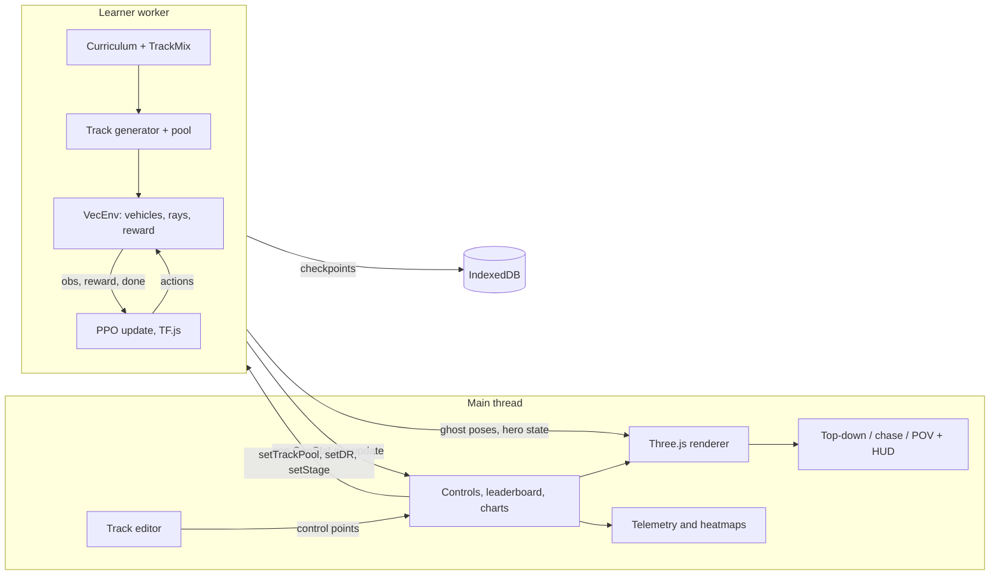

# Architecture

drift-school is a TypeScript app with no backend. A deterministic vehicle simulator, a PPO trainer and a Three.js renderer sit behind a few typed contracts. This page describes what is in the repository today. Where the code differs from [SPEC.md](../SPEC.md), the difference is stated.

## The one rule

`src/sim`, `src/track`, `src/rl` and the env code in `src/workers` never import Three.js, uPlot, `ui/` or `viz/`, and never touch DOM globals or `Math.random`. ESLint enforces that with `no-restricted-imports`, `no-restricted-globals` and `no-restricted-properties` (see `eslint.config.js`). Training can therefore run headless, in a worker, or in Node (`npm run eval` does exactly that).

## Data flow

Differences from the SPEC diagram:

- The learner worker owns the rollout and the update. `src/workers/env.worker.ts` can step a `VecEnv` on its own and answers `setTrackPool`, but the page does not run a four-worker `SharedArrayBuffer` farm.
- Rapier is used by the keyboard drive page (`/dev/drive.html`) for wall contact. `VecEnv` bounces cars off the wall polylines with a restitution impulse instead of stepping a Rapier world per car.
- The learner streams pose frames to the page at about 30 Hz while a rollout runs, so ghosts keep moving between PPO updates.
- Cross-origin isolation headers come from the Vite dev and preview servers. On GitHub Pages, which cannot set headers, `public/coi-serviceworker.js` rewrites responses and the page reloads once.

## Modules

| Directory | Role |
| --- | --- |
| `src/shared` | Contracts: `TrackSpec`, `CarParams`, `CarState`, `GenStat`, message types, the sfc32 RNG with `fork(label)`, constants, and the weight hash. |
| `src/track` | Seeded generator, spline and resampling, validator, `buildTrackFromPoints`, pure-pursuit baseline. |
| `src/sim/car` | Tire, suspension, drivetrain, steering, and the `Vehicle` that integrates them. |
| `src/sim` | `VecEnv`, ray sensors with a wall grid for culling, reward and termination, domain randomization, Rapier wall world. |
| `src/rl` | Policy and value networks, PPO, the training recipe (DAgger, then validation-gated PPO), hot-swap fine-tune, curriculum, track mix, seed sets, generation stats, checkpoints. |
| `src/editor` | Stroke cleanup (RDP, Chaikin), the drawing overlay, URL-hash sharing. |
| `src/viz` | Renderer, track mesh, interpolation, and the three cameras. |
| `src/ui` | Controls, leaderboard, uPlot charts, telemetry, heatmaps. |
| `src/workers` | Learner worker, env worker, worker pool helpers. |
| `src/eval` | The acceptance-table harness behind `npm run eval`. |

## Determinism

Every random draw goes through `makeRng(seed, label)`, which forks by label. `Math.random` is not used in the sim. The same seed gives the same `TrackSpec`, the same domain-randomized car, and the same trajectory for the same actions. The unit tests check byte-identical tracks and identical trajectories from twin vehicles. The policy's own action noise is TF.js sampling, which is not part of that guarantee.

## Track generation and validation

`generateTrack({ seed, stage })` samples jittered polar points, takes a hull, displaces midpoints, pushes close points apart, limits the turn angle for the stage, fits a closed centripetal Catmull-Rom spline and resamples it every 0.1 m. Each sample carries position, tangent, normal, curvature, arc length, half-width and surface grip `mu`. Edges, wall polylines and checkpoint gates come from the samples. An invalid track retries with `seed + 1`.

The editor and the generator share one validator. It reports a reason code and a location: `open`, `selfIntersect`, `minRadius`, `tooShort`, `tooLong`, `edgeOverlap`, `bounds`, `startStraight`. Fixtures of known-bad tracks live in `tests/fixtures/tracks-bad`.

`tRef`, the reference lap time, is an analytic integral of a curvature speed profile. `simulateBaseline` in `src/track/baseline.ts` runs the pure-pursuit car through the vehicle model as a separate check.

## Vehicle model

A 1:10 RC car, 1.6 kg, 0.26 m wheelbase.

- **Suspension.** Four spring-dampers plus anti-roll. Per-wheel normal load comes from the spring force, so weight transfer under braking and cornering falls out of the model.
- **Tires.** Pacejka magic formula with load-sensitive peak grip, a friction ellipse for combined slip, and a blend to a damper below 0.5 m/s. Front and rear have separate B, C, E.
- **Drivetrain and steering.** Motor torque falls linearly with speed with a 30 ms lag. 4WD with a front/rear split, or RWD. The steering servo is rate limited.
- **Integration.** Semi-implicit Euler, 10 physics substeps (500 Hz) per 50 Hz control step. The policy acts every control step in `VecEnv`; the SPEC's 25 Hz action hold is not implemented.

## Observation, action, reward

`OBS_DIM = 48`, documented index by index in [`src/sim/OBS_LAYOUT.md`](../src/sim/OBS_LAYOUT.md): 21 rays in a 200° fan (6 m, with noise and dropout), body-frame velocities, yaw rate, slip angles and ratios, previous action, wheel load shares, lateral offset and heading error from the centerline, curvature at five look-ahead distances, time left, roll, pitch, speed and progress. A rays-only flag zeroes the track-relative features.

The action is `[steer, throttle]` in `[-1, 1]`, squashed with tanh. Negative throttle brakes, then reverses at a standstill.

Reward and termination live in `src/sim/reward.ts`: progress along the centerline, a lap bonus plus a speed bonus against `tRef`, penalties for leaving the track, hitting walls, jerky inputs, wrong-way driving and time, and terminations for sustained off-track, wrong way, being stuck, or hitting the step cap. Rewards are scaled by a running standard deviation.

## Training

The network is an MLP, 48→128→128 with tanh, a mean head for the two actions with a learned log-std, and a separate value network of the same size. PPO uses GAE (λ 0.95, γ 0.99), a 0.2 clip, Adam at 3e-4, advantage normalization and an entropy bonus.

**Training recipe.** `trainRecipe` in `src/rl/recipe.ts` is the one function the app runs and `npm run eval` measures. It has two phases. First, DAgger (`src/rl/dagger.ts`) distils the pure-pursuit controller into the policy, stage by stage from 0 to 3, over stage-appropriate track pools with domain randomization off, low and high and mixed asphalt, carpet and dirt. Second, a short PPO fine-tune: critic warm-up, small learning rate, tight clip and gradient-norm clip, with every update reverted if it scores worse on held-out validation seeds (`src/rl/validate.ts`). Essentially all of the driving skill comes from the first phase; PPO moves lap time by about 1% at this budget. Training, validation and eval seeds never overlap (`src/rl/seeds.ts`), and the same seed gives identical weights. The browser runs the same function for stage 0 only, with a shorter schedule (`BROWSER_TUNE`) and without the gated PPO phase, then keeps running plain PPO for as long as the page is open. See [ACCEPTANCE.md](ACCEPTANCE.md) for what the eval shows about each phase.

**Curriculum.** Five stages (`src/rl/curriculum.ts`) with a promotion rule on recent completion and, at stage 2, lap time against `tRef`. Stage sampling replays earlier stages 20% of the time.

**Track mix and hot-swap.** "Train on this" posts `setTrackPool` with the drawn control points. Messages that change the trainer are deferred until the running update ends, so a rollout never straddles a swap. The learner snapshots the pre-swap model and starts a `FineTune` (`src/rl/finetune.ts`), which runs in three phases. In *drain*, each env finishes its running episode and then restarts on the drawn track; an env still mid-episode after 8 s is moved anyway. No gradient step runs, so the weight hash is unchanged. In *zero-shot*, the first episodes on the drawn track run with no update, and their completion rate is reported. In *tune*, the pool becomes 70% drawn track and 30% procedural replay (`TrackMix`: entropy 0.02 for 20 updates, learning-rate warm restart), and each PPO update is followed by DAgger batches labelled by the pure-pursuit controller. The base model is saved and the new weights are forked to `user-<hash>` in IndexedDB. The page shows the progress in an adaptation panel.

## Rendering

`ThreeRenderer` builds the track mesh from a `TrackSpec`, draws up to 64 instanced cars, interpolates the 30 Hz pose stream, and drops a tire-mark ribbon when rear slip is high. Cameras are separate classes behind the renderer: top-down (orthographic), chase (spring-damped with a wall-aware boom) and in-car POV, plus a DOM HUD. Quality presets are `low` and `high`. WebGPU is attempted when `navigator.gpu` exists, with WebGL2 as the fallback.

Not implemented from the SPEC's graphics list: GTAO, TAA, cascaded shadow maps, bloom, auto-exposure.

## Sharing

A drawn track is stored in the URL hash: the control points are quantized to millimetres, packed with the half-width and `mu`, deflated with `fflate` and base64url encoded. The round trip is within 1 mm, which `tests/editor/share.test.ts` checks. Checkpoints are saved to IndexedDB. There is no server and no account.

## Where to start reading

1. `src/shared/types.ts` for the contracts.
2. `src/sim/car/vehicle.ts` and `src/sim/car/tire.ts` for the physics.
3. `src/sim/vecEnv.ts`, `src/sim/reward.ts` and `src/sim/sensors.ts` for the environment.
4. `src/rl/recipe.ts`, `src/rl/trainer.ts` and `src/rl/finetune.ts` for training and the hot-swap.
5. `src/workers/learner.worker.ts` and `src/main.ts` for how the pieces are wired in the browser.
